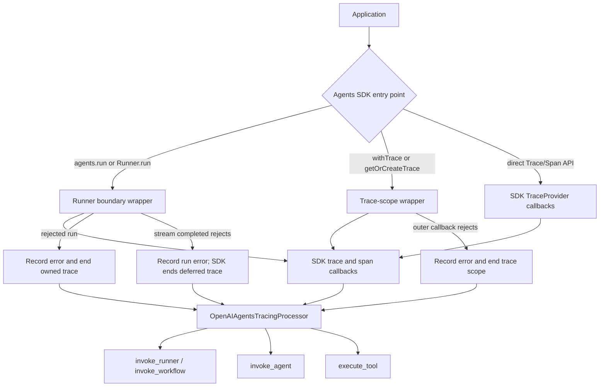

# OpenTelemetry OpenAI Agents Instrumentation for Node.js

[![NPM Published Version][npm-img]][npm-url]
[![Apache License][license-image]][license-image]

This module provides automatic OpenTelemetry instrumentation for the
[`@openai/agents`](https://www.npmjs.com/package/@openai/agents) JavaScript SDK.
It uses the SDK's tracing processor callbacks to emit GenAI agent and
function-tool spans.

Compatible with OpenTelemetry JS API and SDK `1.0+`.

## Installation

```bash
npm install --save @opentelemetry/instrumentation-openai-agents
```

## Supported Versions

- [`@openai/agents`](https://www.npmjs.com/package/@openai/agents) versions `>=0.14.0 <1`

## Usage

Register the instrumentation before loading `@openai/agents`:

```js
const { NodeSDK } = require('@opentelemetry/sdk-node');
const {
  OpenAIAgentsInstrumentation,
} = require('@opentelemetry/instrumentation-openai-agents');

const sdk = new NodeSDK({
  instrumentations: [new OpenAIAgentsInstrumentation()],
});
sdk.start();

process.once('beforeExit', async () => {
  await sdk.shutdown();
});
```

### Instrumented SDK entry points

All of the following use the same SDK trace processor and produce the same
span hierarchy:

```ts
// Top-level helper (internally uses Runner.run).
await agents.run(agent, 'Summarize this request');

// Explicit runner invocation.
const runner = new agents.Runner();
await runner.run(agent, 'Summarize this request');

// Streaming invocation. The run span remains open until `completed` settles.
const streamed = await runner.run(agent, 'Stream a response', { stream: true });
for await (const event of streamed) {
  consume(event);
}
await streamed.completed;

// Caller-managed trace scopes, including rejected callbacks.
await agents.withTrace('customer-workflow', async () => {
  await runner.run(agent, 'Run inside this trace');
});

await agents.getOrCreateTrace(async () => {
  await runner.run(agent, 'Reuse an active trace or create one');
});
```

The SDK's `TraceProvider` callbacks are also observed for traces and spans
created directly with the Agents tracing API. This includes agent, task, turn,
and function-tool callbacks, nested agents and tools, handoffs, retries, and
callback-reported errors. Task and turn callbacks are used to build hierarchy
and propagate terminal errors; they do not create duplicate OpenTelemetry
spans.

### How the instrumentation works



The wrappers are lifecycle safety hooks, not a second tracing implementation.
They preserve the SDK's native callbacks and only fill gaps where a rejected
run or stream would otherwise leave an OpenTelemetry span open.

### What is not instrumented

This package intentionally does not instrument:

- OpenAI API/HTTP model calls or token-usage spans. Use
  [`@opentelemetry/instrumentation-openai`](https://www.npmjs.com/package/@opentelemetry/instrumentation-openai)
  for those calls.
- The SDK's native OpenAI trace exporter, unless
  `disableOpenAITraceExport` is enabled.
- Separate OpenTelemetry spans for task, turn, generation, response, guardrail,
  custom, transcription, speech, or MCP list-tools callback types. Unsupported
  SDK callback types are retained only as hierarchy, usage, model-metadata, or
  error context where applicable.
- Realtime/voice tracing APIs exposed outside the core `Runner` and trace
  lifecycle covered above.
- Parentage between agent spans and spans produced by other instrumentations,
  such as the model-call spans from
  [`@opentelemetry/instrumentation-openai`](https://www.npmjs.com/package/@opentelemetry/instrumentation-openai).
  Those spans are still recorded, but they begin a **separate trace** rather
  than nesting under `invoke_agent`.

  The SDK invokes processor callbacks synchronously on the task that starts and
  ends each span, so the callback pairing that context propagation needs does
  exist. What is missing is a detachable context primitive in OpenTelemetry
  JavaScript: its context API offers `context.with(fn)`, which needs a function
  to wrap, and no `attach`/`detach` pair of the kind the Python GenAI
  instrumentation uses to make the same callbacks nest. Making the callback's
  context active for the remainder of the surrounding asynchronous scope is
  possible, but it cannot be undone when the span ends, which leaks the context
  into unrelated work.

### Options

| Option                     | Type                    | Default  | Description                                                                                                                                                                                                                                                                                                     |
| -------------------------- | ----------------------- | -------- | --------------------------------------------------------------------------------------------------------------------------------------------------------------------------------------------------------------------------------------------------------------------------------------------------------------- |
| `captureMessageContent`    | `'none' \| 'span_only'` | `'none'` | Controls capturing of message content, system instructions, tool definitions, and function tool arguments/results. Set to `'span_only'` to capture them on span attributes (this may expose sensitive data). Can also be set with `OTEL_INSTRUMENTATION_GENAI_CAPTURE_MESSAGE_CONTENT=span_only`. Note that SDK message capture also requires the SDK's `traceIncludeSensitiveData: true` (default). |
| `disableOpenAITraceExport` | `boolean`               | `false`  | Replace the Agents SDK trace processors with the OpenTelemetry processor, disabling its native OpenAI trace export. By default both processors run. Set this before the Agents SDK is loaded; changing it after processor registration is ignored to avoid removing application processors.                       |

The OpenAI client instrumentation remains responsible for model-call spans.
This package emits the agent orchestration spans and preserves the SDK's task
and turn spans as hierarchy and usage callbacks, avoiding duplicate LLM spans.

The JavaScript tracing callbacks are lifecycle notifications; they do not keep
an OpenTelemetry context active between start and end. This instrumentation
therefore constructs the runner, agent, and tool hierarchy explicitly, but
model-call spans from separate client instrumentation are not guaranteed to be
children of the agent span. Guaranteeing that relationship would require an
additional runner-boundary context hook.

## Spans

| Agents SDK callback          | OpenTelemetry span                 | `gen_ai.operation.name` |
| ---------------------------- | ---------------------------------- | ----------------------- |
| Runner trace                 | `invoke_runner [<workflowName>]`   | `invoke_runner`         |
| User `withTrace(...)` trace  | `invoke_workflow [<name>]`         | `invoke_workflow`       |
| Agent span                   | `invoke_agent <name>`              | `invoke_agent`          |
| Function span                | `execute_tool <name>`              | `execute_tool`          |
| Handoff span                 | `execute_tool transfer_to_<agent>` | `execute_tool`          |

## Useful links

- For more information on OpenTelemetry, visit: <https://opentelemetry.io/>
- For more about OpenTelemetry JavaScript: <https://github.com/open-telemetry/opentelemetry-js>
- For help or feedback on this project, join us in [GitHub Discussions][discussions-url]

## License

Apache 2.0 - See [LICENSE][license-url] for more information.

[discussions-url]: https://github.com/open-telemetry/opentelemetry-js/discussions
[license-url]: https://github.com/open-telemetry/opentelemetry-js-contrib/blob/main/LICENSE
[license-image]: https://img.shields.io/badge/license-Apache_2.0-green.svg?style=flat
[npm-url]: https://www.npmjs.com/package/@opentelemetry/instrumentation-openai-agents
[npm-img]: https://badge.fury.io/js/%40opentelemetry%2Finstrumentation-openai-agents.svg
